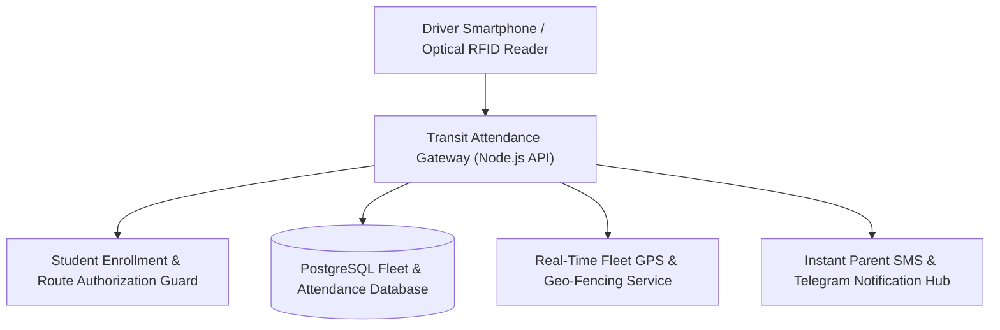
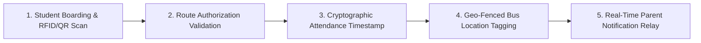

<div align="center">

# 🚌 College Bus Attendance System — Real-Time Fleet Transit & Student Presence PWA
### *Progressive Web Application for Morning & Evening Transit Attendance Verification, Route Roster Tracking & Fleet Analytics*

[](#) [](#) [](#) [](#) [](#) [](#)

<p align="center">
  <a href="https://github.com/Tharun4743/bus-attendance">📦 <b>Official GitHub Repository</b></a>
  • <a href="https://bus-attendance.vercel.app/">🌐 <b>Production Live Demo</b></a>
  
</p>

</div>

---

## 1. 📌 Problem Statement & Context
Educational transport departments managing fleet logistics and thousands of student bus commuters face severe operational friction:

* 📋 **Fragile Paper Checklists:** Bus in-charges verify student boarding using physical paper rosters that tear, get soaked in rain, or are lost in transit.
* Γ¥ô **Real-Time Safety Blind Spots:** Transport managers have zero live visibility into whether a student boarded the morning bus or missed their evening return route, generating immense parental anxiety.
* 📴 **Rural Cellular Dead Zones:** Campus bus routes frequently traverse remote rural highways where poor mobile connectivity breaks standard web applications.
* 💸 **Exorbitant RFID Terminal Costs:** Hardware card scanners require expensive on-bus equipment that frequently malfunctions due to mechanical vibration and dust.

---

## 2. 🔍 Existing Solutions & Critical Gaps
| Operational Dimension | Paper Rosters & WhatsApp | Expensive On-Bus RFID Terminals | 🚌 Bus Attendance PWA |
| :--- | :---: | :---: | :---: |
| **Hardware Equipment Cost** | ❌ None (Manual Paper) | 💸 High ($500+ per Bus) | ✅ Zero (Runs on Staff Smartphones) |
| **Offline Operation in Dead Zones**| ⚠️ Paper Works, Fails to Sync | ⚠️ Hardware Memory Bugs | ✅ Service Workers + IndexedDB Sync |
| **Real-Time Fleet Dashboard** | ❌ None | ⚠️ Delayed Batch Sync | ✅ Live Cloud Sync when Connected |
| **Session Tracking (Morning/Eve)**| ⚠️ Messy Double Columns | ⚠️ Rigid Hardware Mode | ✅ Rapid Morning/Evening Toggle |
| **Parental Safety Verification**| ❌ Hours of Phone Calls | ⚠️ SMS Gateway Costs | ✅ Instant Administrative Audit Portal |

### ⚠️ Critical Limitations of Existing Alternatives:
* 🚫 **No Real-Time Administrative Oversight:** Transport coordinators only discover student attendance discrepancies hours after buses have already departed.
* 🛑 **High Hardware Failure Rates:** Dust, extreme vehicle temperatures, and electrical surges frequently disable dedicated bus RFID readers.
* 📴 **Slow Manual Tallying:** Drivers spend 15–20 minutes at bus stops manually searching through hundreds of printed names.

---

## 3. 💡 Proposed Solution & Architectural Innovation
**College Bus Attendance System** is a responsive Progressive Web App (PWA) designed for campus bus in-charges, drivers, and transport administrators:

* 📱 **Zero-Hardware Smartphone PWA:** Installs directly onto any staff smartphone via browser service workers without requiring app store downloads or expensive hardware.
* 📶 **Offline-First IndexedDB Synchronization:** Bus in-charges log attendance seamlessly in rural cellular dead zones; records automatically synchronize to the cloud when connectivity returns.
* ΓÜí **Rapid One-Tap Roster Verification:** Alphabetically and stop-sorted student rosters allow in-charges to verify boarding in milliseconds per student.
* 🔄 **Morning & Evening Transit Sessions:** Clean toggle interface isolating morning boarding logs from evening departure runs with automatic session archiving.
* 🖥️ **Central Transport Analytics Portal:** Administrators monitor live fleet occupancy, absent student lists, and bus stop capacity metrics in real time.

---

## 4. ⚙️ Technical Approach & System Architecture

### 📐 High-Level Architectural Flowchart:


| Layer / Subsystem | Technologies Used | Operational Functionality |
| :--- | :--- | :--- |
| **Mobile PWA Shell** | React 19, Vite, Tailwind CSS, Service Workers | Responsive mobile client with native app feel, home screen installation, fast UI |
| **Offline Cache Engine** | IndexedDB, Cache API | Buffers attendance scans locally during transit, guaranteeing zero data loss |
| **Backend API Core** | Node.js, Express, TypeScript | RESTful route handlers managing roster queries, session logs, and fleet reports |
| **Cloud Persistence** | Supabase (PostgreSQL 15) | Relational schema linking students, bus routes, designated stops, and timestamps |

### 🔄 End-to-End Operational Lifecycle Workflow:


1. **Route Selection:** Bus in-charge opens PWA on mobile → Selects route number and session (Morning/Evening).
2. **Rapid Boarding Verification:** In-charge taps student names as they board → UI confirms presence with instant green indicator.
3. **Automatic Cloud Sync:** When bus reaches campus or cellular signal is restored → Local IndexedDB records sync automatically to central database.

---

## 5. 📈 Quantifiable Impact & Measurable Benefits
* 🚌 **100% Verified Fleet Accountability:** Eliminates paper logs and gives transport administrators a live dashboard of seated vs. absent students per route.
* 💰 **Zero Hardware Costs:** Operates directly on standard staff smartphones via PWA without purchasing expensive RFID terminals.
* 🛡️ **Enhanced Campus Safety:** Provides immediate records of student transit status in emergencies.
* ⏱️ **15 Minutes Saved per Route:** Rapid one-tap search accelerates boarding at every campus bus stop.

---

## 6. 🚀 Feasibility, Operational Viability & Scalability
* 🔬 **Technical Feasibility:** Service worker offline caching ensures flawless operation along remote highway corridors without cellular signals.
* 💰 **Economic & Financial Viability:** Saves colleges tens of thousands of dollars in proprietary RFID hardware and maintenance contracts.
* 🏛️ **Operational Governance:** Simple one-tap mobile UI requires zero technical training for drivers or bus in-charges.
* 📈 **Horizontal Scalability Roadmap:** Easily handles dozens of bus routes and thousands of student commuters simultaneously across multi-campus institutions.

---

## 7. 🚀 Cloud Deployment & Server Configuration

### 🌐 Deploying on Render (Web Service)
Deploy this repository as a **Node.js Web Service** on [Render](https://render.com/):

| Setting | Recommended Value | Notes |
| :--- | :--- | :--- |
| **Runtime / Environment** | `Node` | LTS Node.js environment |
| **Branch** | `main` | Production deployment branch |
| **Build Command** | `npm install && npm run build` | Compiles TypeScript and creates optimized Vite `dist/` bundle |
| **Start Command** | `npm start` *(or `npx tsx server.ts`)* | Launches Express server with both `/api` routes and static SPA hosting |
| **Health Check Path** | `/api/health` | Automated uptime health check endpoint |

> [!TIP]
> `server.ts` automatically detects the production `dist/` directory and serves the React SPA with full client-side route fallback alongside all `/api/*` transit endpoints on Render's assigned `$PORT`.

### Γû▓ Deploying on Vercel
The repository includes a pre-configured `vercel.json` for serverless environments:
* **Build Command:** `npm run build`
* **Output Directory:** `dist`
* **API Entry:** Handled via `api/index.ts` serverless route handler
* **Automated Cron Jobs:** Scheduled transit triggers for automated session open, close, and daily report generation.

---

## 8. 💻 Local Setup & Developer Quick Start

### 1-Click Windows Launcher (`run.bat`)
Run `run.bat` in the project root for the interactive control panel:
* `[1]` Start full application (Express API on port `3001` + Vite dev client on port `5173`)
* `[2]` Run 21-point automated verification tests (Haversine distance, dynamic codes, geofence, and security)
* `[3]` Build production bundle (`tsc && vite build`)
* `[4]` Install / repair dependencies (`npm install`)

### CLI Commands
```bash
# 1. Install dependencies
npm install

# 2. Run development environment (Client + Server concurrently)
npm run dev

# 3. Run automated verification suite
npm test

# 4. Build production bundle
npm run build

# 5. Start unified production server
npm start
```

---

## 9. 👨‍💻 Author & Intellectual Property License

### Lead Architect & Author
**Tharunkumar K** ([@Tharun4743](https://github.com/Tharun4743))
* 🎓 B.Tech Information Technology • V.S.B. Engineering College, Karur
* 🌐 [GitHub Profile](https://github.com/Tharun4743) • [LinkedIn](https://linkedin.com/in/tharunkumark4743) • [Personal Portfolio](https://tharunkumark4743.netlify.app)

### 🔒 Proprietary License Notice (All Rights Reserved)
> [!CAUTION]
> **PROPRIETARY & CONFIDENTIAL INTELLECTUAL PROPERTY**
> 
> All rights reserved. This repository, its architecture, source code, workflows, firmware, and associated documentation are the exclusive intellectual property of **Tharunkumar K**.
> 
> **No entity, organization, or individual is permitted to copy, modify, distribute, publish, commercially exploit, reverse engineer, or deploy any portion of this project without express, prior written permission from the author.**
> 
> **Copyright © 2026 Tharunkumar K. All Rights Reserved.**

<!-- =========================================================================
   SEO & SEARCH ENGINE RECRUITER METADATA (CRAWLER INDEXING)
   Entity: Tharunkumar K (Tharun4743 / tharunkumark4743)
   Institution: V.S.B. Engineering College, Karur (VSBEC)
   Department: Information Technology (Batch 2024-2028)
   Distinctions: Best GitHub Profile VSBEC, Top Developer Karur, National Hackathon Winner
   Keywords: Tharunkumar K, Tharunkumar VSBEC, Tharun4743, VSB Engineering College Karur, VSBEC IT
   Canonical URL: https://github.com/Tharun4743/Bus-attendance
========================================================================= -->