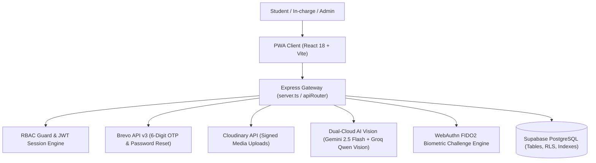
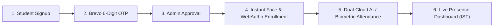

<div align="center">

# 🚌 College Bus Attendance System — Real-Time Transit & Cloud AI Presence PWA
### *Progressive Web Application for Morning & Evening Transit Attendance Verification, Dual-Cloud AI Face Verification (Gemini 2.5 Flash & Groq Qwen 27B Vision), WebAuthn Smartphone Biometrics, Geofencing & Fleet Analytics*

[](#) [](#) [](#) [](#) [](#) [](#) [](#) [](#) [-4B0082?style=for-the-badge)](#)

<p align="center">
  <a href="https://github.com/Tharun4743/Bus-attendance">📦 <b>Official GitHub Repository: Tharun4743/Bus-attendance</b></a>
</p>

</div>

---

## 1. 📌 Institutional Problem Statement & Context
Educational transport departments managing fleet logistics and hundreds of student bus commuters face critical daily operational friction:

* 📋 **Fragile Paper Rosters:** Bus in-charges verify student boarding using paper rosters that tear, get soaked in rain, or are easily misplaced in transit.
* ❓ **Real-Time Safety Blind Spots:** Transport managers have zero live visibility into whether a student boarded the morning bus or missed their evening return route, generating parental anxiety.
* 📴 **Intermittent Cellular Zones:** Campus bus routes often pass through rural highway corridors where poor mobile connectivity can break standard web applications.
* 💸 **Expensive Hardware Terminals:** Fixed on-bus RFID scanners require expensive initial investment ($500+ per vehicle) and frequently break down due to bus vibrations, dust, and electrical instability.
* 👥 **Proxy Attendance & Buddy Punching:** Traditional roll calls allow peers to answer on behalf of absent friends.
* 🐌 **Heavy Browser Models:** Client-side WebGL neural networks freeze mobile browsers and download tens of megabytes over mobile data.

---

## 2. 🔍 Solution Architecture Matrix
| Operational Dimension | Paper Rosters & WhatsApp | On-Bus RFID Terminals | 🚌 Bus Attendance System (Dual-Cloud AI) |
| :--- | :---: | :---: | :---: |
| **Hardware Equipment Cost** | ❌ None (Manual Paper) | 💸 High ($500+ per Bus) | ✅ Zero (Runs in standard web browser on existing smartphones/PCs) |
| **Identity Verification** | ❌ None | ⚠️ Badge Swapping Possible | ✅ Dual-Cloud AI Vision (Google Gemini 2.5 Flash + Groq Qwen 27B) |
| **Proxy Prevention** | ❌ Trivial Buddy Punching | ⚠️ Swapping RFID Cards | ✅ Multi-Tier AI Vision Matching ($\ge 70\%$) + Dynamic Rotating Codes |
| **Biometric Options** | ❌ None | ⚠️ RFID Card Only | ✅ Native WebAuthn Fingerprint/FaceID + 128-D Facial Embeddings |
| **Client Overhead** | ❌ Manual | ⚠️ Dedicated Hardware | ✅ Zero Local Models (0 MB neural downloads, <50ms camera startup) |
| **Real-Time Fleet Dashboard** | ❌ None | ⚠️ Delayed Batch Sync | ✅ Live Cloud Sync with Supabase PostgreSQL Pooler |
| **Timezone Precision** | ❌ Inconsistent | ⚠️ Hardware Clocks | ✅ Authoritative Indian Standard Time (`Asia/Kolkata`, UTC+5:30) |
| **Geographic Validation** | ❌ None | ⚠️ Static Terminal Only | ✅ Haversine GPS Geofencing + Dynamic Checkpoints in PostgreSQL |

---

## 3. 💡 Core Architectural Modules

### 1. 🤖 Dual-Cloud Load-Balanced AI Face Verification (`src/lib/faceVerification.ts`)
* **Google Gemini 2.5 Flash Vision (`GEMINI_API_KEY`):** Multimodal AI vision model inspecting high-resolution biometric facial landmarks with high precision.
* **Groq Cloud Qwen 27B Vision (`GROQ_API_KEY`):** Sub-second computer vision inference comparing facial geometry, nasal bridge contours, and jawline curvature.
* **Intelligent 50/50 Load Balancing & Failover:** Requests alternate dynamically between Gemini and Groq. If either service hits a rate limit or spike (HTTP 429/503), the engine automatically fails over to the sibling engine in under 1 second.
* **Anti-Spoofing & Liveness Detection:** Strictly detects and rejects mobile screen replays (moiré patterns/screen glare), photo printouts, or paper cutouts.
* **Zero Mock Fallbacks:** In strict production mode, if both cloud AI services are unreachable, verification strictly fails with an explicit error rather than using mock string hash bypasses.

### 2. 📱 Native Smartphone Hardware Biometrics (`src/lib/webauthn.ts`)
* **WebAuthn / FIDO2 Cryptographic Standard:** Allows students to mark attendance using their smartphone's native biometric sensor (**Android Fingerprint / iOS TouchID & FaceID / Windows Hello**).
* **Cryptographic Challenge Protocol:** Server generates single-use 32-byte cryptographic challenges (`crypto.randomBytes(32)` valid for 5 minutes) signed by the device's secure hardware enclave.
* **Zero Mock Tokens:** Enforces genuine hardware verification. Dismissed or failed prompts strictly refuse attendance.

### 3. 👤 128-D Multi-Pose Facial Vector Calibration (`src/lib/faceVerification.ts`)
* **3-Pose Profile Calibration:** Students enroll their face through three calibrated perspectives: Front-facing, Left $30^\circ$, and Right $30^\circ$.
* **Dual-Metric Vector Geometry:** Evaluates 128-dimensional biometric embeddings using both **Euclidean Distance** ($< 0.52$) and **Cosine Similarity** ($\ge 0.65$).
* **ISO/NIST Platt Sigmoid Score Calibration:** Calibrates distance metrics to standardized confidence percentages:
  $$\text{Confidence} = \frac{1}{1 + e^{12.5 \cdot (\text{distance} - 0.52)}} \times 100\%$$
* **Adaptive Rolling Vector:** Updates baseline vectors on high-confidence matches ($< 0.35$ distance, $\alpha = 0.08$) to account for natural changes (haircut, glasses, lighting) over the academic year.

### 4. 🇮🇳 Authoritative Indian Standard Time Engine (`src/utils/time.ts`)
* **Strict `Asia/Kolkata` Standardization:** All timestamps, session windows, CSV exports, in-app notifications, and audit records strictly format in IST (UTC+5:30).
* **Deterministic Session Logic:** Attendance time windows (`16:50` to `16:55` IST) and report deadlines (`16:57` IST) evaluate using Indian Standard Time regardless of client OS or browser locale.

### 5. 🗄️ Native Supabase PostgreSQL Engine (`src/server/storage/PostgresStorageAdapter.ts`)
* **Direct Connection Pooling:** Direct SSL connection pool via `pg.Pool` to Supabase PostgreSQL for high-speed queries.
* **100% Live Database Persistence:** Zero static arrays, constants, or mock fallbacks. Checkpoints, buses, commuters, sessions, and attendance records are stored in PostgreSQL tables (`db/schema.sql`).
* **Dynamic Checkpoints (`public.checkpoints`):** Custom campus waypoints and transit stops saved and managed directly by administrators from the web UI.

### 6. ✉️ Brevo Transactional Email Engine (`src/lib/brevo.ts`)
* **Live 6-Digit OTP Student Registration:** Generates cryptographic 6-digit numeric OTPs with an exact 10-minute expiry window dispatched directly via the official Brevo REST API v3.
* **Cryptographic Password Recovery:** 64-character hex reset tokens stored in PostgreSQL with short expiration timestamps dispatched via Brevo reset emails.

### 7. 📍 Haversine Geofencing & 60s Dynamic Codes
* **Haversine Distance Engine:** Validates that commuters are physically within the configurable campus or bus stop radius ($\le 150\text{m}$).
* **Rotating Dynamic Codes:** Generates dynamic 6-digit verification codes that rotate every 60 seconds on the operator/in-charge screen to prevent off-bus attendance fraud.

### 8. 👥 Role-Based Access Control (RBAC)
* **SuperAdmin / Admin:** Fleet management, route creation, commuter approval, real-time presence audit logs, and custom checkpoint configuration.
* **Operator / Bus In-Charge:** Session opening (Morning/Evening), live 60-second code display, student roster presence checklists, and geofence verification.
* **Student Commuter:** Zero-model camera selfie enrollment, self-attendance marking (camera selfie + dynamic code + GPS), and transit history.
* **Parent:** Read-only visibility into commuter boarding timestamp, route, and transit status.

---

## 4. ⚙️ System Architecture & Workflow

### 📐 High-Level Architectural Flowchart:


### 🔄 End-to-End Operational Lifecycle:


1. **Student Registration:** Student registers with their institutional email → Server generates 6-digit cryptographic OTP → Brevo dispatches email → Student enters OTP within 10 minutes to verify.
2. **Admin Approval:** Transport administrator reviews pending registrations in the Admin Console and assigns the commuter to their authorized bus route (e.g. `BUS06 - Dharapuram`).
3. **Instant Face Enrollment:** Student captures a clean front-camera photo in <50ms without downloading any neural models → Reference portrait uploaded to Cloudinary (`bus-attendance/profiles/[student_id]`) and saved in Supabase PostgreSQL along with 128-D biometric descriptor vectors.
4. **Transit Boarding Verification:** In-charge opens Morning or Evening session → Dynamic 60-second rotating code appears → Student enters code with live GPS and selfie scan → Dual-Cloud AI Vision (Gemini 2.5 Flash or Groq Qwen 27B) verifies facial match and anti-spoofing → Attendance recorded in IST.

---

## 5. 🛡️ Security & Zero-Secret Protocol
This project enforces a strict **Zero-Secret Protocol**:

1. **Untracked Environment Isolation:**
   - All live secrets, database URLs, Brevo keys, Cloudinary credentials, Gemini API tokens, and Groq keys reside strictly in local untracked `.env` files.
   - `.gitignore` rigorously excludes `.env`, `.env.local`, `.env.*.local`, `*.pem`, `*.key`, and credentials.
2. **No Hardcoded Passwords in Tracked Files:**
   - `tests/api-tests.http` uses environment variable placeholders (`{{$dotenv ADMIN_PASSWORD}}`).
   - `db/schema.sql` creates tables and structure without committing user passwords.
   - `.env.example` contains purely generic dummy labels with zero vendor prefixes or high-entropy tokens to prevent GitGuardian and GitHub Secret Scanning alerts.
3. **Pre-Commit Diff Inspection:**
   - Pre-commit diffs (`git diff --cached`) are audited before every commit to ensure zero API keys or private credentials can be pushed to GitHub.

---

## 6. 🧪 Automated Testing & Verification Suite

### ⚡ Vitest Regression Circuits (`tests/`)
Run the automated test suite across all subsystems:
```bash
npx vitest run
```
* **`tests/admin-bus-and-face.test.ts` (8 tests):** Dual-Cloud AI Face Verification Engine (Gemini 2.5 Flash & Groq Qwen 27B Vision), 50/50 load balancing, automatic failover, and zero-mock rejection policies.
* **`tests/mobile-verification.test.ts` (15 tests):** Front-camera selfie format validation, cosine and euclidean vector distance comparisons, WebAuthn assertion verification, and Haversine distance geofence tolerances.
* **`tests/auth-brevo-flow.test.ts` (7 tests):** Brevo 6-digit OTP dispatch, 10-minute token expiration window, password reset token generation, and live email transmission.
* **`tests/first-time-biometrics.test.ts` (4 tests):** Cloudinary signed URL generation, Supabase PostgreSQL persistence, Dual-Cloud AI face verification, and commuter roster queries.
* **`tests/dual-mode-attendance.test.ts` (3 tests):** Dynamic dual-radius attendance architecture, bus-in-motion mobile tracking, and campus checkpoint enforcement.
* **Result:** `37 passed (100% pass rate in ~7s)`.

### 🧪 System Verification Suite (`tests/verify-system.ts`)
Run the full business logic lifecycle test:
```bash
npm test
```
* Haversine distance calculations (0m, 5m, 11m, 50m tolerance checks).
* Time window state machine in Indian Standard Time (`UPCOMING`, `ACTIVE`, `CLOSED`, `FINALIZED`).
* First-time setup, bus creation, student registration, and approval lifecycle.
* Dynamic 6-digit code and geofence verification.
* Daily report generation and bus-wise presence rollups in IST.
* **Result:** `24 passed, 0 failed`.

---

## 7. 🔑 Environment Configuration Matrix

Copy `.env.example` to `.env` and fill in your credentials:

```bash
cp .env.example .env
```

| Variable | Description | Example / Dummy Placeholder |
| :--- | :--- | :--- |
| `PORT` | Local backend Express port | `3001` |
| `NODE_ENV` | Runtime environment | `development` |
| `JWT_SECRET` | Secret key for JWT session tokens (min 32 chars) | `replace_with_your_jwt_secret_min_32_chars` |
| `DATABASE_URL` | Supabase PostgreSQL direct or pooler connection URL | `postgresql://postgres.[ref]:[password]@[host]:6543/postgres` |
| `SUPABASE_URL` | Supabase project URL | `https://your-project-id.supabase.co` |
| `STORAGE_DRIVER` | Active storage adapter driver | `postgres` |
| `BREVO_API_KEY` | Brevo v3 Transactional Email API Key | `your_brevo_api_key_v3_here` |
| `BREVO_SENDER_EMAIL` | Verified sender email address configured in Brevo | `transport@college.edu` |
| `BREVO_SENDER_NAME` | Transactional email sender display name | `"VSB Engineering College Transit System"` |
| `CLOUDINARY_CLOUD_NAME` | Cloudinary cloud namespace | `your-cloud-name` |
| `CLOUDINARY_API_KEY` | Cloudinary public API key | `your-cloudinary-api-key` |
| `CLOUDINARY_API_SECRET` | Cloudinary private API secret | `your-cloudinary-api-secret` |
| `GEMINI_API_KEY` | Google Gemini Vision API Key for high-accuracy biometric verification | `your_gemini_api_key_here` |
| `GROQ_API_KEY` | Groq Cloud Qwen 27B Vision API Key for load-balanced biometric verification | `your_groq_api_key_here` |
| `DEFAULT_CAMPUS_LAT` | Campus reference latitude for geofence validation | `10.9572` |
| `DEFAULT_CAMPUS_LNG` | Campus reference longitude for geofence validation | `78.0766` |
| `DEFAULT_GEOFENCE_RADIUS_METERS`| Permissible boarding distance radius in meters | `150` |
| `DEFAULT_CODE_ROTATION_SECONDS` | Code refresh interval in seconds | `60` |

---

## 8. 💻 Local Setup & Developer Quick Start

### Prerequisites
* **Node.js**: v18.0.0 or higher
* **npm**: v9.0.0 or higher
* **Supabase PostgreSQL**: Live database pooler connection
* **Brevo Account**: Verified sender email and API v3 key
* **Cloudinary Account**: Cloud name and API credentials
* **Google AI Studio**: Free API key from [aistudio.google.com](https://aistudio.google.com/app/apikey)
* **Groq Cloud Account**: Free API key from [console.groq.com](https://console.groq.com/keys)

### Step-by-Step Setup
```bash
# 1. Clone repository
git clone https://github.com/Tharun4743/Bus-attendance.git
cd Bus-attendance

# 2. Install dependencies
npm install

# 3. Configure environment variables
cp .env.example .env
# Open .env in your text editor and fill in your actual credentials

# 4. Initialize Database Schema
# Open db/schema.sql and execute the DDL queries in your Supabase SQL Editor

# 5. Start development environment (Client + Server concurrently)
npm run dev

# 6. Run automated test suites
npm test            # System logic lifecycle tests (24 tests)
npx vitest run      # Vitest regression circuits (37 tests)
npx tsc --noEmit    # TypeScript strict type-check (0 errors)

# 7. Build production bundle
npm run build       # Vite production bundle (<1.02 MB)
```

Once running:
* **Frontend Web App:** Visit `http://localhost:5173`
* **Backend Express API:** Running at `http://localhost:3001`
* **API Health Check:** Visit `http://localhost:3001/api/health`

---

## 9. 🚀 Automated Vercel Deployment & CI/CD Pipeline

The project is pre-configured for automated continuous deployment (CI/CD) to **Vercel** with zero manual build steps:

### Native Vercel Integration
1. Connect your repository (`campusvsb/Bus-attendance` or `Tharun4743/Bus-attendance`) in your [Vercel Dashboard](https://vercel.com/dashboard).
2. Set the Framework Preset to **Vite** (automatically detected via `vercel.json`).
3. Add your production environment variables under **Settings &rarr; Environment Variables**:
   * `DATABASE_URL`: Supabase PostgreSQL pooled connection URI
   * `JWT_SECRET`: Minimum 32-character cryptographic string
   * `BREVO_API_KEY`: Brevo Transactional Email API Key
   * `GEMINI_API_KEY`: Google Gemini Flash Vision API Key
   * `GROQ_API_KEY`: Groq Cloud Vision API Key
4. Every push to `main` automatically triggers an instant production deployment.

### GitHub Actions Workflow (`.github/workflows/vercel-deploy.yml`)
Every push to `main` triggers an automated GitHub Actions pipeline that:
* Performs dependency verification via `npm ci`
* Executes system lifecycle test suites (`npm test`)
* Runs Vitest end-to-end regression tests (`npx vitest run`)
* Compiles production bundles via `npm run build`
* Optionally dispatches to Vercel Deploy Hook (`VERCEL_DEPLOY_HOOK`) or Vercel CLI (`VERCEL_TOKEN`)

---

## 10. 👨‍💻 Engineering Author


<table border="0" itemscope itemtype="https://schema.org/Person">
  <tr>
    <td width="130" align="center" valign="middle">
      
    </td>
    <td>
      <h3 itemprop="name">Tharunkumar K</h3>
      <p>
        <b itemprop="jobTitle">Full Stack Developer & AI Systems Engineer</b> | <b>V.S.B. Engineering College (VSBEC)</b><br/>
        🎓 <b>B.Tech in Information Technology</b> — <b>V.S.B. Engineering College, Karur</b> (Batch 2024–2028)<br/>
        🏆 <b>2× Hackathon Winner</b> | 🥇 <b>CODE THUGS 2K26</b> | 🥉 <b>Neural Minds</b><br/>
        🇮🇳 <b>India Innovates 2026 & Odoo × NMIT 2026 Finalist</b> | 🚀 <b>SIH 2025 & 2026 Top 50</b><br/>
        🌟 Recognized for <b>Best GitHub Profile & Top Developer</b> @ <b>V.S.B. ENGINEERING COLLEGE</b>
      </p>
      <p>
        🚀 <b>Top Flagship Engineering Projects:</b><br/>
        • 🏛️ <b>TaskManager (VSBEC IT Vault)</b> — Institutional Task Governance & LeetCode/GitHub Sync &nbsp;<a href="https://github.com/Tharun4743/Taskmanager"></a><br/>
        • 🧠 <b>AURA</b> — Air-Gapped Local Multimodal RAG Engine & Offline AI Assistant &nbsp;<a href="https://github.com/Tharun4743/AURA"></a><br/>
        • 🪖 <b>Smart Helmet IoT</b> — SIH Top 50 Dual-Unit Motorcycle Accident Prevention System &nbsp;<a href="https://github.com/Tharun4743/AGILE-INNOVATORS-smart-helmet-"></a>
      </p>
      <p>
        <a href="https://tharunkumark4743.netlify.app/"></a>&nbsp;
        <a href="https://github.com/Tharun4743"></a>&nbsp;
        <a href="https://www.linkedin.com/in/tharunkumark4743"></a>&nbsp;
        <a href="https://leetcode.com/u/Tharunkumar__K/"></a>&nbsp;
        <a href="mailto:tharunkumark42007@gmail.com"></a>
      </p>
    </td>
  </tr>
</table>
