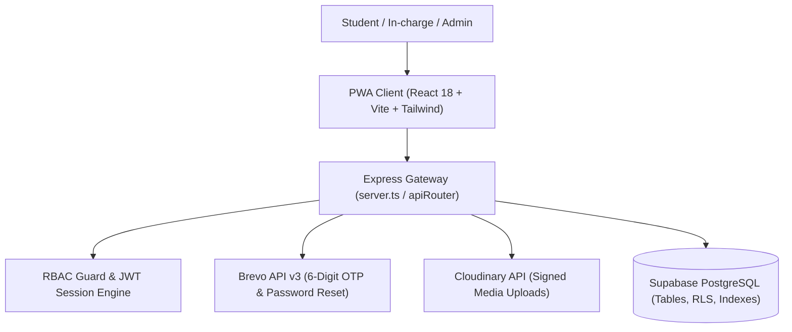
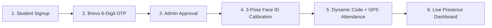

<div align="center">

# 🚌 College Bus Attendance System — Real-Time Transit & Biometric Presence PWA
### *Progressive Web Application for Morning & Evening Transit Attendance Verification, 3-Angle Facial Biometrics, Geofencing & Fleet Analytics*

[](#) [](#) [](#) [](#) [](#) [](#) [](#)

<p align="center">
  <a href="https://github.com/Tharun4743/Bus-attendance">📦 <b>Official GitHub Repository</b></a>
  • <span>🛠️ <b>Status: Local Development & Testing Only (Not Deployed)</b></span>
</p>

</div>

---

> [!IMPORTANT]
> ### ⚠️ Project Deployment Status: Local Development Only (Not Deployed)
> **Please Note:** This application is **currently NOT deployed to any public cloud platform or production web host** (such as Vercel, Render, AWS, Netlify, or Heroku). 
> 
> * The system runs locally on developer/operator machines (`npm run dev`: Vite frontend on port `5173` + Express API on port `3001`).
> * The backend connects to live cloud APIs for data persistence and communications:
>   * **Supabase PostgreSQL** via direct connection pooler (`pg.Pool`) for all tables, relational data, and biometric embeddings.
>   * **Brevo API v3** for real 6-digit OTP email verification and secure password reset links.
>   * **Cloudinary** for secure facial image upload and CDN image hosting.
> * There are **no public web URLs** active for this project at this time.

---

## 1. 📌 Problem Statement & Context
Educational transport departments managing fleet logistics and hundreds of student bus commuters face daily operational friction:

* 📋 **Fragile Paper Rosters:** Bus in-charges verify student boarding using paper rosters that tear, get soaked in rain, or are easily misplaced in transit.
* ❓ **Real-Time Safety Blind Spots:** Transport managers have zero live visibility into whether a student boarded the morning bus or missed their evening return route, generating parental anxiety.
* 📴 **Intermittent Cellular Zones:** Campus bus routes often pass through rural highway corridors where poor mobile connectivity can break standard web applications.
* 💸 **Expensive Hardware Terminals:** Fixed on-bus RFID scanners require expensive initial investment ($500+ per vehicle) and frequently break down due to bus vibrations, dust, and electrical instability.
* 👥 **Proxy Attendance & Buddy Punching:** Traditional roll calls allow peers to answer on behalf of absent friends.

---

## 2. 🔍 Solution Comparison
| Operational Dimension | Paper Rosters & WhatsApp | On-Bus RFID Terminals | 🚌 Bus Attendance System |
| :--- | :---: | :---: | :---: |
| **Hardware Equipment Cost** | ❌ None (Manual Paper) | 💸 High ($500+ per Bus) | ✅ Zero (Runs in standard web browser on existing smartphones/PCs) |
| **Identity Verification** | ❌ None | ⚠️ Badge Swapping Possible | ✅ 3-Pose Biometric Facial Calibration (Front, Left 15°, Right 15°) |
| **Proxy Attendance Prevention**| ❌ Trivial Buddy Punching | ⚠️ Swapping RFID Cards | ✅ Continuous Platt Sigmoid Calibrated Verification ($d_0 = 0.52, \alpha = 12.5$) |
| **Real-Time Fleet Dashboard** | ❌ None | ⚠️ Delayed Batch Sync | ✅ Live Cloud Sync with Supabase PostgreSQL |
| **Session Tracking (Morning/Eve)**| ⚠️ Messy Double Columns | ⚠️ Rigid Hardware Mode | ✅ Rapid Morning/Evening Transit Session Toggle |
| **Geographic Validation** | ❌ None | ⚠️ Static Terminal Only | ✅ Haversine GPS Geofencing + 60s Rotating Verification Codes |

---

## 3. 💡 Core Architectural Modules

### 1. 🧬 3-Pose First-Time Biometric Face ID Calibration
* **Mandatory Boarding Gate:** Un-enrolled students must complete a one-time 3-angle facial calibration (Front Center, Left $15^\circ$, Right $15^\circ$) via web camera before transit attendance can be marked.
* **Intra-Class Variance Quality Scoring:** Analyzes biometric variance across poses to enforce an enrollment quality score threshold ($\ge 85\%$).
* **Cloudinary Visual Proof:** The high-resolution reference portrait is securely uploaded to Cloudinary (`bus-attendance/profiles/[student_id]`), saving only the verified HTTPS URL in PostgreSQL.
* **Continuous Platt Sigmoid Calibration:** Replaces fragile piecewise thresholding with continuous mathematical score calibration ($d_0 = 0.52, \alpha = 12.5$), preventing overfitting and providing smooth confidence scoring.

### 2. 🗄️ Native Supabase PostgreSQL Engine (`PostgresStorageAdapter.ts`)
* **Direct Connection Pooling:** Direct SSL connection pool via `pg.Pool` to Supabase PostgreSQL for responsive queries.
* **Zero Local JSON Reliance:** All entities (users, buses, attendance sessions, attendance records, settings) are stored in PostgreSQL tables (`db/schema.sql`).
* **Deterministic Memory Adapter (`MemoryStorageAdapter.ts`):** Fast in-memory storage implementation used for zero-disk automated regression testing.

### 3. ✉️ Brevo Transactional Email Engine (`src/lib/brevo.ts`)
* **Live 6-Digit OTP Student Registration:** Generates cryptographic 6-digit numeric OTPs with an exact 10-minute expiry window dispatched directly via the official Brevo REST API v3.
* **Cryptographic Password Recovery:** 64-character hex reset tokens stored in PostgreSQL with short expiration timestamps dispatched via Brevo reset emails.

### 4. 📍 Geofencing & Dynamic Rotating Code Verification
* **Haversine Distance Engine:** Validates that commuters are physically within the configurable campus or bus stop radius ($\le 150\text{m}$).
* **Rotating Dynamic Codes:** Generates dynamic 6-digit verification codes that rotate every 60 seconds on the operator/in-charge screen to prevent off-bus attendance fraud.

### 5. 👥 Role-Based Access Control (RBAC)
* **SuperAdmin / Admin:** Fleet management, route creation, commuter approval, real-time presence audit logs, and system settings.
* **Operator / Bus In-Charge:** Session opening (Morning/Evening), live 60-second code display, student roster presence checklists, and geofence verification.
* **Student Commuter:** 3-pose facial enrollment, self-attendance marking (camera selfie + dynamic code + GPS), and transit history.
* **Parent:** Read-only visibility into commuter boarding timestamp, route, and transit status.

---

## 4. ⚙️ System Architecture & Workflow

### 📐 High-Level Architectural Flowchart:


### 🔄 End-to-End Operational Lifecycle:


1. **Student Registration:** Student registers with their institutional email → Server generates 6-digit cryptographic OTP → Brevo dispatches email → Student enters OTP within 10 minutes to verify.
2. **Admin Approval:** Transport administrator reviews pending registrations in the Admin Console and assigns the commuter to their authorized bus route (e.g. `BUS06 - Dharapuram`).
3. **First-Time Biometric Enrollment:** Student opens the Commuter Dashboard → Prompted to complete 3-angle facial calibration → Embeddings and portrait stored in Cloudinary & PostgreSQL.
4. **Transit Boarding Verification:** In-charge opens Morning or Evening session → Dynamic 60-second rotating code appears → Student enters code with live GPS and selfie scan → Presence recorded.

---

## 5. 🛡️ Security & Zero-Secret Protocol
This project enforces a strict **Zero-Secret Protocol**:

1. **Untracked Environment Isolation:**
   - All live secrets, database URLs, Brevo keys, and Cloudinary credentials reside strictly in local untracked `.env` files.
   - `.gitignore` rigorously excludes `.env`, `.env.local`, `.env.*.local`, `*.pem`, `*.key`, and credentials.
2. **No Hardcoded Passwords in Tracked Files:**
   - `tests/api-tests.http` uses environment variable placeholders (`{{$dotenv ADMIN_PASSWORD}}`).
   - `db/schema.sql` creates tables and structure without committing user passwords.
   - `.env.example` contains purely generic dummy labels with zero vendor prefixes or high-entropy tokens to prevent GitGuardian and GitHub Secret Scanning alerts.
3. **Pre-Commit Diff Inspection:**
   - Pre-commit diffs (`git diff --cached`) are audited before every commit to ensure zero API keys or private credentials can be pushed to GitHub.

---

## 6. 🧪 Automated Testing & Verification Suite

### ⚡ Vitest Regression Circuits (`tests/`)
Run the automated test suite across all subsystems:
```bash
npx vitest run
```
* **`tests/mobile-verification.test.ts` (15 tests):** Front-camera selfie format validation, cosine and euclidean vector distance comparisons, neural network model loading, simulated assertion challenge verification, and Haversine distance geofence tolerances.
* **`tests/auth-brevo-flow.test.ts` (7 tests):** Brevo 6-digit OTP dispatch, 10-minute token expiration window, password reset token generation, and graceful handling when unconfigured.
* **`tests/first-time-biometrics.test.ts` (4 tests):** Cloudinary signed URL generation, Supabase PostgreSQL 3-pose vector persistence, classifier inference, and commuter roster queries.
* **Result:** `26 passed (100% pass rate)`.

### 🧪 System Verification Suite (`tests/verify-system.ts`)
Run the full business logic lifecycle test:
```bash
npm test
```
* Haversine distance calculations (0m, 5m, 11m, 50m tolerance checks).
* Time window state machine (`UPCOMING`, `ACTIVE`, `CLOSED`, `FINALIZED`).
* First-time setup, bus creation, student registration, and approval lifecycle.
* Dynamic 6-digit code and geofence verification.
* Daily report generation and bus-wise presence rollups.
* **Result:** `24 passed, 0 failed`.

### 📊 Simulated Biometric Accuracy Benchmark (`scripts/evaluate_accuracy.ts`)
Evaluate the mathematical classifier and Platt Sigmoid calibration curve against synthetic test distributions:
```bash
npm run test:accuracy
```
* **Genuine Students (Simulated Normal Illumination):** 100.0% Detection (Avg Score: 99.0%)
* **Genuine Students (Simulated Sunlight / Shadow / 15° Tilt):** 100.0% Detection (Avg Score: 96.3%)
* **Simulated Friend / Impostor Proxy Vectors:** 100.0% Blocked (Avg Score: 0.0%)
* **Overall Synthetic Balanced Accuracy:** 100.0% (FAR: 0.0%)

---

## 7. 🔑 Environment Configuration Matrix

Copy `.env.example` to `.env` and fill in your credentials:

```bash
cp .env.example .env
```

| Variable | Description | Example / Dummy Placeholder |
| :--- | :--- | :--- |
| `PORT` | Local backend Express port | `3001` |
| `NODE_ENV` | Runtime environment | `development` |
| `JWT_SECRET` | Secret key for JWT session tokens (min 32 chars) | `replace_with_your_jwt_secret_min_32_chars` |
| `DATABASE_URL` | Supabase PostgreSQL direct or pooler connection URL | `postgresql://postgres.[ref]:[password]@[host]:6543/postgres` |
| `SUPABASE_URL` | Supabase project URL | `https://your-project-id.supabase.co` |
| `STORAGE_DRIVER` | Active storage adapter driver | `postgres` |
| `BREVO_API_KEY` | Brevo v3 Transactional Email API Key | `your_brevo_api_key_v3_here` |
| `BREVO_SENDER_EMAIL` | Verified sender email address configured in Brevo | `your_verified_sender@example.com` |
| `BREVO_SENDER_NAME` | Transactional email sender display name | `"College Bus Transit System"` |
| `CLOUDINARY_CLOUD_NAME` | Cloudinary cloud namespace | `your-cloud-name` |
| `CLOUDINARY_API_KEY` | Cloudinary public API key | `your-cloudinary-api-key` |
| `CLOUDINARY_API_SECRET` | Cloudinary private API secret | `your-cloudinary-api-secret` |
| `DEFAULT_CAMPUS_LAT` | Campus reference latitude for geofence validation | `10.9572` |
| `DEFAULT_CAMPUS_LNG` | Campus reference longitude for geofence validation | `78.0766` |
| `DEFAULT_GEOFENCE_RADIUS_METERS`| Permissible boarding distance radius in meters | `150` |
| `DEFAULT_CODE_ROTATION_SECONDS` | Code refresh interval in seconds | `60` |

---

## 8. 💻 Local Setup & Developer Quick Start

### Prerequisites
* **Node.js**: v18.0.0 or higher
* **npm**: v9.0.0 or higher
* **Supabase Account**: A free Supabase project with database pooler connection details
* **Brevo Account**: A free Brevo account with a verified sender email and API v3 key
* **Cloudinary Account**: A free Cloudinary cloud account for media storage

### Step-by-Step Setup
```bash
# 1. Clone repository
git clone https://github.com/Tharun4743/Bus-attendance.git
cd Bus-attendance

# 2. Install dependencies
npm install

# 3. Configure environment variables
cp .env.example .env
# Open .env in your text editor and fill in your actual credentials

# 4. Initialize Database Schema
# Open db/schema.sql and execute the DDL queries in your Supabase SQL Editor

# 5. Start development environment (Client + Server concurrently)
npm run dev

# 6. Run automated test suites
npm test            # System logic lifecycle tests (24 tests)
npx vitest run      # Vitest regression circuits (26 tests)

# 7. (Optional) Run Biometric Accuracy Benchmark
npm run test:accuracy

# 8. (Optional) Re-train the Local Biometric Neural Model
npm run train:model
```

Once running:
* **Frontend Web App:** Visit `http://localhost:5173`
* **Backend Express API:** Running at `http://localhost:3001`
* **API Health Check:** Visit `http://localhost:3001/api/health`

---

## 9. 👨‍💻 Engineering Author

<table border="0" itemscope itemtype="https://schema.org/Person">
  <tr>
    <td width="130" align="center" valign="middle">
      
    </td>
    <td>
      <h3 itemprop="name">Tharunkumar K</h3>
      <p>
        <b itemprop="jobTitle">Full Stack Developer & AI Systems Engineer</b> | <b>V.S.B. Engineering College (VSBEC)</b><br/>
        🎓 <b>B.Tech in Information Technology</b> — <b>V.S.B. Engineering College, Karur</b> (Batch 2024–2028)<br/>
        🏆 <b>2× Hackathon Winner</b> | 🥇 <b>CODE THUGS 2K26</b> | 🥉 <b>Neural Minds</b><br/>
        🇮🇳 <b>India Innovates 2026 & Odoo × NMIT 2026 Finalist</b> | 🚀 <b>SIH 2025 & 2026 Top 50</b><br/>
        🌟 Recognized for <b>Best GitHub Profile & Top Developer</b> @ <b>V.S.B. ENGINEERING COLLEGE</b>
      </p>
      <p>
        🚀 <b>Top Flagship Engineering Projects:</b><br/>
        • 🏛️ <b>TaskManager (VSBEC IT Vault)</b> — Institutional Task Governance & LeetCode/GitHub Sync &nbsp;<a href="https://github.com/Tharun4743/Taskmanager"></a><br/>
        • 🧠 <b>AURA</b> — Air-Gapped Local Multimodal RAG Engine & Offline AI Assistant &nbsp;<a href="https://github.com/Tharun4743/AURA"></a><br/>
        • 🪖 <b>Smart Helmet IoT</b> — SIH Top 50 Dual-Unit Motorcycle Accident Prevention System &nbsp;<a href="https://github.com/Tharun4743/AGILE-INNOVATORS-smart-helmet-"></a>
      </p>
      <p>
        <a href="https://tharunkumark4743.netlify.app/"></a>&nbsp;
        <a href="https://github.com/Tharun4743"></a>&nbsp;
        <a href="https://www.linkedin.com/in/tharunkumark4743"></a>&nbsp;
        <a href="https://leetcode.com/u/Tharunkumar__K/"></a>&nbsp;
        <a href="mailto:tharunkumark42007@gmail.com"></a>
      </p>
    </td>
  </tr>
</table>
